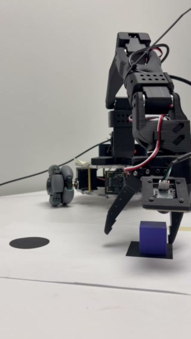
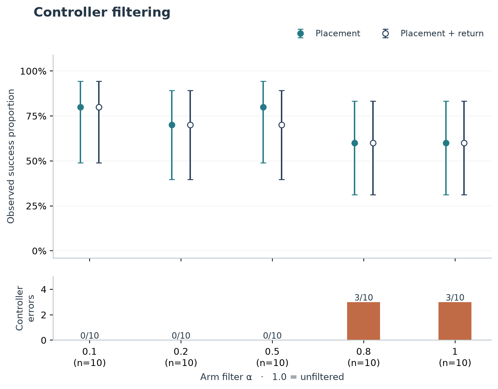
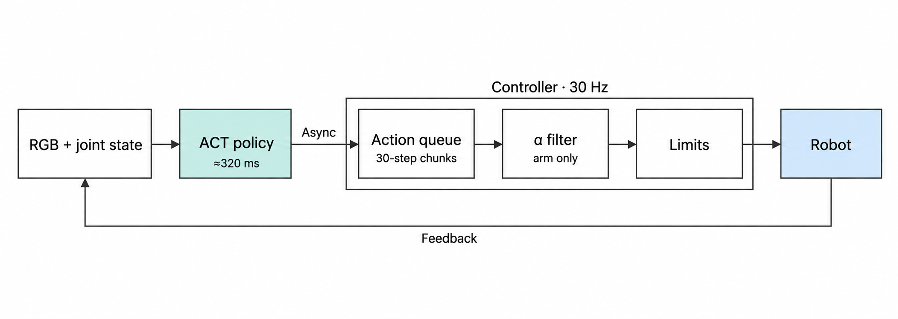

# Mickey17 · learning to pick and place

I taught a low-cost robot to pick up a cube and place it at a target circle using **Action Chunking with Transformers (ACT)**. I collected the demonstrations, trained the policy, made it run on a CPU, and tested what happens when I change the controller filter or the scene.

<a href="assets/hero_demo.mp4"></a>

**[Watch the demo · MP4, 24 s](assets/hero_demo.mp4)**

*Successful supervised rollout at α = 0.5. A hand steadies the base during this recording.*

## What I built

I wanted to work through the whole pipeline, from moving the robot myself to understanding its successes and failures.

- **Demonstrations:** leader–follower teleoperation, wrist-camera recording, cleaning and merging a final set of 158 demonstrations.
- **Training:** ACT through LeRobot's official training pipeline, with 134 training episodes and 24 held-out episodes. I selected the 18,000-step checkpoint.
- **CPU deployment:** asynchronous inference and an action queue that keeps executing while the next chunk is predicted.
- **Controller refinement:** overlapping-chunk blending, an arm command filter, and empirical execution limits.
- **Evaluation:** repeated physical trials, operator progress labels, placement timing, controller logs and reproducible analysis.

ACT and the model implementation come from [the ACT authors](https://arxiv.org/abs/2304.13705) and [Hugging Face LeRobot](https://github.com/huggingface/lerobot). My work is the task, data, integration, deployment refinements and experiments around them.

## Results

I evaluated **95 distinct primary trials** over 40-second windows. Placement means the cube was placed; placement plus return also requires the arm to return. Circle-overlap quality is a separate label.



*Filtering changes execution behavior. Dots show observed success, bars show Wilson 95% intervals, and the lower panel counts controller stops.*

| Arm filter α | Placement | Placement + return | Controller stops | Placement time: median (timed n) |
| --- | --- | --- | --- | --- |
| 0.1 | 8/10 | 8/10 | 0/10 | 29.44 s (8) |
| 0.2 | 7/10 | 7/10 | 0/10 | 19.99 s (7) |
| 0.5 | 8/10 | 7/10 | 0/10 | 26.25 s (7) |
| 0.8 | 6/10 | 6/10 | 3/10 | 18.97 s (6) |
| 1.0 · unfiltered | 6/10 | 6/10 | 3/10 | 28.20 s (6) |

The lower-alpha groups avoided controller stops. Their success intervals overlap, so this is an exploratory comparison. Timing uses recorded placements only; missing times remain missing.

**Scene changes were harder.** At α = 0.5, shifting the base 2 cm left gave 2/5 placements and shifting right gave 0/5, versus 8/10 at the original position. Cube rotations of 0°, 10°, 30°, 45°, 60° and 80° gave 8/10, 3/10, 0/10, 0/5, 0/5 and 1/5. The original-position and 0° groups reuse the same ten α = 0.5 trials.

The [full report](docs/RESULTS.md) includes uncertainty intervals, scene comparisons, individual times and six-joint traces. Nine additional base-right attempts and three preliminary tests are accounted for separately. The older 70-trial study uses different scoring and stays separate.

[](assets/alpha_comparison.mp4)

*[Watch the three-alpha comparison](assets/alpha_comparison.mp4): original speed, elapsed video time and explicit clip endings. These independent recordings illustrate motion; they are not synchronized scored trials.*

## How the system works



*Inference runs asynchronously; the queue and controller run at a requested 30 Hz. Logged inference had a median of 321 ms across 8,300 completed chunks.*

ACT predicts 30 actions from a wrist image and robot state. I request another chunk about every 12 control frames. The first inference holds the starting pose. After that, the queue discards already-past entries from each arriving chunk and blends predictions assigned to the same future cycle.

Scheduling answers **which action belongs to this moment**. The α filter smooths the first five arm commands over time; it leaves the gripper unchanged. Smaller α applies more smoothing. Controller checks bound the resulting targets, while raw proposal checks can stop execution before filtering.


*My collection setup: SO-101 leader and follower, LeKiwi base, one wrist camera and an Intel N95 NUC. Deployment uses CPU inference and holds base velocity at zero.*

## What I learned

Offline command prediction was only part of the problem. On hardware I saw oscillation, overshoot and controller stops. Filtering helped make execution usable, but it also changes how quickly the arm responds.

Placement exposed another weakness: the wrist view changes as the arm moves, and the gripper can obscure the cube and target. Small changes in base position or cube orientation were enough to disrupt the learned sequence. This made demonstration coverage and camera placement feel as important as model choice.

My hypothesis is that inference delay contributes to a mismatch between the observed state and the state at execution. These experiments do not isolate that mechanism. The useful lesson was to inspect observations, queued proposals, filtered commands and measured motion together.

## Reproduce and explore

Regenerate the current figures and tables from the included numerical evidence (Python 3.11+):

```bash
python3 -m pip install -r requirements-analysis.txt
python3 tools/analyze_outcomes.py --output-dir /tmp/mickey17-analysis
```

Start with the [offline reproduction and training guide](docs/REPRODUCE.md), [experiment definition](experiment_statement.md), and [evaluated rollout code](deployment/rollout_act_overlap.py). The report documents manual labeling, small groups and missing measurements. Weights, demonstration videos and the exact NUC environment remain external; figure reproduction works from this checkout.

Next I want to improve demonstration coverage and test image augmentation. [Real-Time Chunking](https://www.pi.website/research/real_time_chunking) and VLA policies are future exploration.

Built on [ACT](https://arxiv.org/abs/2304.13705) and [LeRobot ACT](https://huggingface.co/docs/lerobot/act). [Attribution and licenses](docs/THIRD_PARTY_NOTICES.md) · [source provenance](docs/SOURCE_OF_TRUTH.md) · [my original README](docs/archive/README-author-draft-2026-11-02.md).
