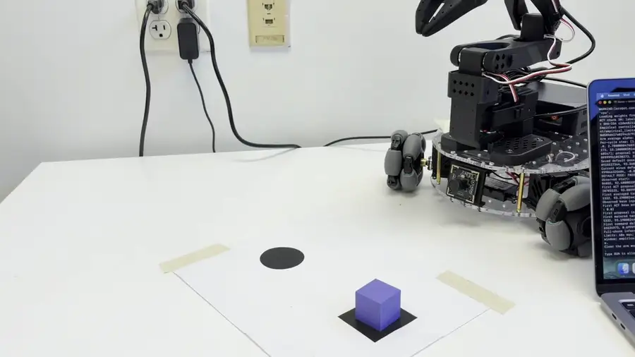
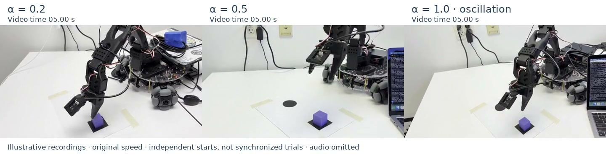
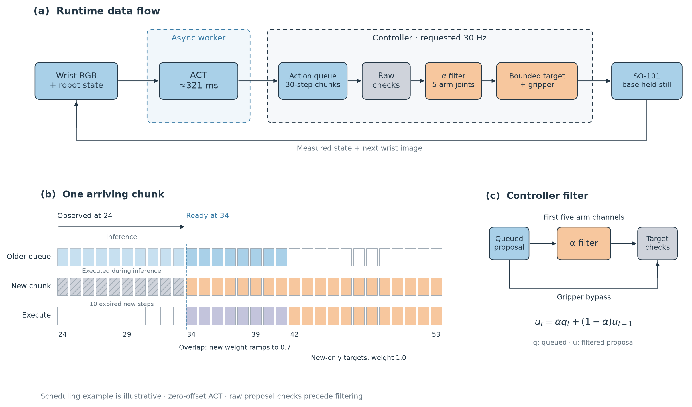
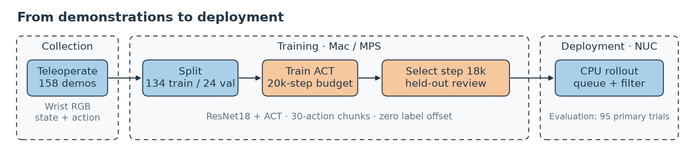
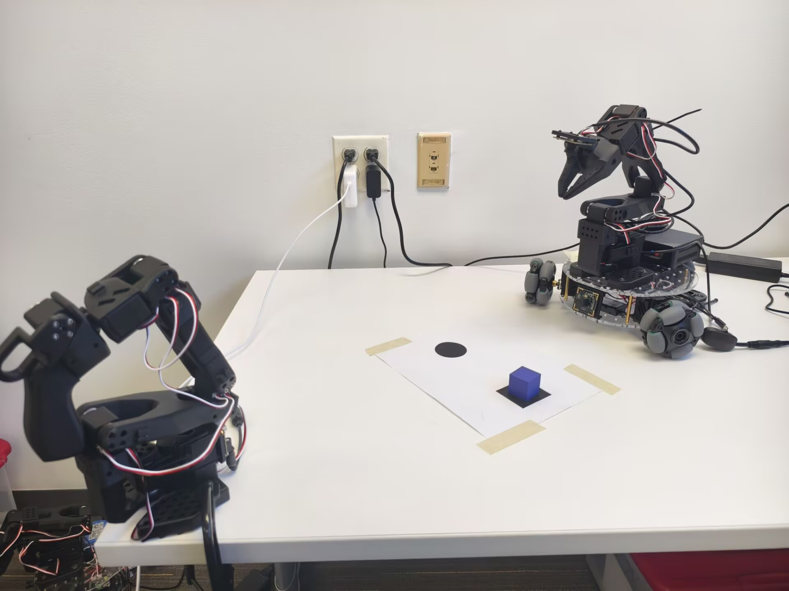

<div align="center">

# Mickey17

**My imitation learning practice**

[Demo](https://lanetang.github.io/mickey17-imitation-learning/media/landscape.html) · [Results](#4-results) · [System](#5-about-this-system) · [Reproduce](#7-reproduction-guide)

</div>

## 1. TL;DR

I taught a low-cost robot to pick and place from demonstrations using **ACT**, then worked on chunk scheduling and a controller-side blend filter to make it run on a CPU.

**158 demonstrations · One wrist camera · CPU inference**

## 2. Hero Demo

<a href="https://lanetang.github.io/mickey17-imitation-learning/media/landscape.html"></a>

*Pick, transport, place, return. Supervised α = 0.5 demonstration at original speed.*

**[Watch the full recording](https://lanetang.github.io/mickey17-imitation-learning/media/landscape.html)** · [Another recording, from the front](https://lanetang.github.io/mickey17-imitation-learning/media/hero.html)

[](https://lanetang.github.io/mickey17-imitation-learning/media/comparison.html)

*[Compare three α settings](https://lanetang.github.io/mickey17-imitation-learning/media/comparison.html). Independent illustrative recordings at real-time speed, with elapsed video time and marked clip endings.*

## 3. Introduction — What I did?

The task is simple: pick up a cube and place it at a circle. Getting a learned policy to do it consistently on my SO-101 and Intel N95 NUC was the interesting part.

I collected about 200 demonstrations myself and cleaned them into a final dataset of 158 episodes. I trained ACT through LeRobot's official pipeline with 134 training episodes and 24 held-out episodes, selecting the 18,000-step checkpoint. The policy uses one wrist-mounted camera and robot state.

On the NUC, logged inference took a median **321 ms** across 8,300 completed chunks. The robot needs commands while the next inference is running, so I used an asynchronous worker and an overlapping action queue.

I observed oscillation and overshoot during deployment. I refined execution with chunk blending, an arm filter and empirical controller checks, then tested filtering and sensitivity to scene changes. ACT and its model implementation come from [the ACT authors](https://arxiv.org/abs/2304.13705) and [LeRobot](https://github.com/huggingface/lerobot); my work is the demonstrations, integration, execution refinements and evaluation.

## 4. Results

### Experiments

I evaluated **95 distinct primary trials** in 40-second windows. The study covers five α settings, base shifts of ±2 cm and six cube orientations. Groups contain five or ten trials. **α = 1 is the unfiltered baseline.**


*Numbers are trial counts. Whiskers show Wilson 95% intervals. Placement includes ranks 4 and 5; return requires rank 5.*

| α | Placement | Placed + returned | Controller stops | Placement median (timed n) |
| --- | --- | --- | --- | --- |
| 0.1 | 8/10 | 8/10 | 0/10 | 29.44 s (8) |
| 0.2 | 7/10 | 7/10 | 0/10 | 19.99 s (7) |
| 0.5 | 8/10 | 7/10 | 0/10 | 26.25 s (7) |
| 0.8 | 6/10 | 6/10 | 3/10 | 18.97 s (6) |
| 1.0 | 6/10 | 6/10 | 3/10 | 28.20 s (6) |

The lower-alpha groups avoided controller stops in these trials. The broad intervals leave the best alpha unresolved. Placement times use only existing operator markers; missing measurements stay missing.


*At α = 0.5, small scene changes disrupted execution. Origin and 0° reuse the same ten baseline trials.*


*Pooled accounting across all conditions. Controller stops remain failures; their completed phases were not ranked.*

The [full report](docs/RESULTS.md) includes individual times, intervals and failure categories. Nine additional base-right attempts and three preliminary tests are reported separately. The earlier 70-trial study uses different scoring.

### Offline validation figure


*Recorded held-out episode 151, using the same checkpoint as deployment. The BC trace is a historical comparator. Recorded-observation prediction does not measure physical task success.*

### Demo review figure


*Median timed rank-5 α = 0.5 trial. The dotted line marks placement; the curves separate queued, filtered, echoed and observed values. The [unfiltered controller-stop example](analysis/2026-11-01/trajectory_alpha_1_0.png) is selected by earliest trial ID.*

## 5. About this System

### Real-time system diagram



*The worker predicts while queued commands execute. At readiness, past entries of the arriving chunk expire; future entries blend with older predictions.*

I request another chunk about every 12 control frames. Queue blending combines predictions for the **same future cycle**. The α filter smooths commands **over time** across the first five arm channels. The gripper bypasses that filter. Raw checks run before filtering, followed by bounded-target checks.

### Pipeline flow



*From moving the robot myself to training, held-out review and physical evaluation.*

### Platform, environment and task definition



*SO-101 leader–follower setup, wrist camera and LeKiwi base. Deployment uses the NUC CPU and zero base-velocity commands.*

The task progresses through reaching, picking, transporting and placing, followed by return. Rank 4 means placed but not returned; rank 5 includes return. Circle-overlap quality is separate. See my [experiment definition](experiment_statement.md).

## 6. Experiment narrative

Offline predictions looked promising, but physical rollouts exposed problems that recorded observations cannot show. I saw oscillation, overshoot and sensitivity to the scene. The wrist view can also hide the cube and destination during placement.

This was my first demonstration-collection effort, and the data quality and coverage could be better. Labels and placement times are my own observations.

My hypothesis is that inference delay contributes to a mismatch between the observed state and execution state. The current experiments do not isolate that mechanism. Inspecting proposals, commands and measured motion together was more useful than judging the policy from validation loss alone.

## 7. Reproduction guide

Regenerate the figures and tables from the public numerical snapshot with Python 3.11+:

```bash
python3 -m pip install -r requirements-analysis.txt
python3 tools/analyze_outcomes.py --output-dir /tmp/mickey17-analysis
```

The [reproduction guide](docs/REPRODUCE.md) covers the training configuration, offline analysis and hardware dependencies. The evaluated deployment entry point is [rollout_act_overlap.py](deployment/rollout_act_overlap.py).

## 8. Limitations and future expansion

This is an exploratory personal study with small groups, manual labels and limited scene variation. Weights, demonstration videos and the exact NUC environment remain external.

Next I want to improve demonstration coverage, test image and demonstration augmentation, and explore [Real-Time Chunking](https://www.pi.website/research/real_time_chunking) and VLA policies.

## 9. References

[ACT paper](https://arxiv.org/abs/2304.13705) · [LeRobot ACT documentation](https://huggingface.co/docs/lerobot/act) · [Attribution](docs/THIRD_PARTY_NOTICES.md) · [Source provenance](docs/SOURCE_OF_TRUTH.md)

I used Codex to help with code, analysis and presentation. The robot work, observations and editorial choices are mine.
