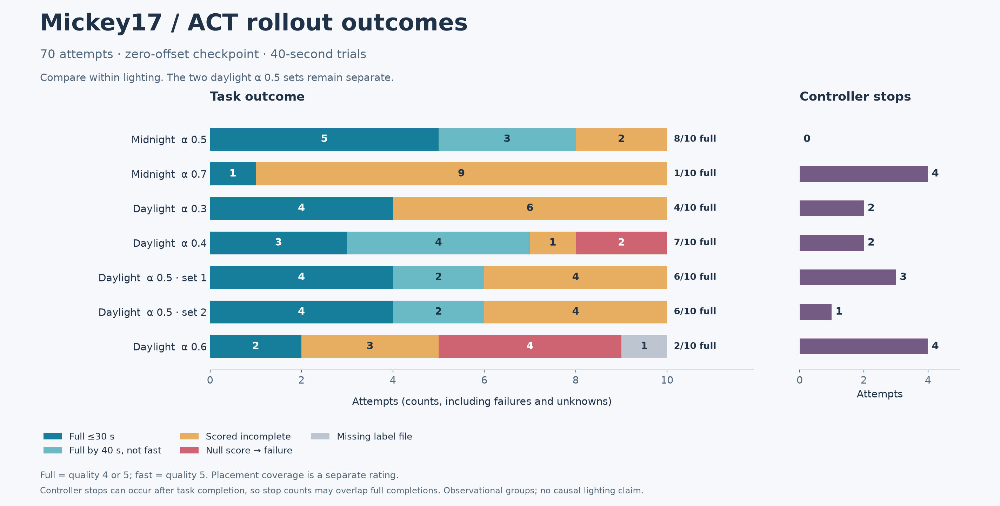
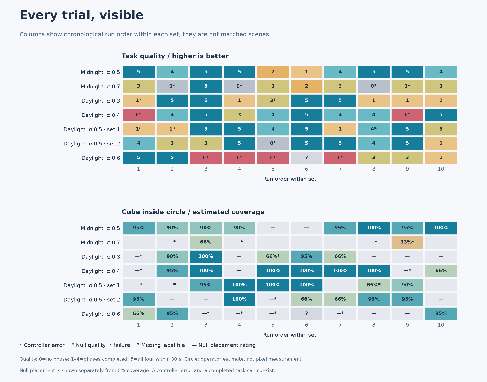

# Current ACT outcomes

Snapshot: 2026-10-25, 70 attempts in seven groups. Source files are preserved. All recorded outcome trials use zero-offset ACT; offset-12 and hybrid results are not yet included.



## Counts and definitions

Full completion = quality 4 or 5. Fast completion = quality 5, within 30 seconds. All denominators include all ten initiated attempts. A null quality is a failure by the operator's stated convention. A missing label file is an unknown outcome. A controller error can occur after a task completes, so errors and completions are not mutually exclusive.

| Operator lighting label | Alpha / set | Full | Fast | Controller errors | Null quality failures | Missing label file |
| --- | --- | --- | --- | --- | --- | --- |
| Midnight | 0.5 | 8/10 | 5/10 | 0/10 | 0 | 0 |
| Midnight | 0.7 | 1/10 | 1/10 | 4/10 | 0 | 0 |
| Daylight | 0.3 | 4/10 | 4/10 | 2/10 | 0 | 0 |
| Daylight | 0.4 | 7/10 | 3/10 | 2/10 | 2 | 0 |
| Daylight | 0.5 / 1 | 6/10 | 4/10 | 3/10 | 0 | 0 |
| Daylight | 0.5 / 2 | 6/10 | 4/10 | 1/10 | 0 | 0 |
| Daylight | 0.6 | 2/10 confirmed | 2/10 confirmed | 4/10 | 4 | 1 |

Alpha-0.6 has one unknown outcome, so its eventual full-completion count could be two or three if that missing label is recovered. It should not be reported as exactly eight observed failures.

## What these results support

- Midnight alpha 0.5 performed substantially better than 0.7 in these sets: eight versus one full completions, and zero versus four controller errors.
- Daylight alpha 0.4 has the highest observed full-completion count among tested daylight settings (seven). Its one-trial advantage over each alpha-0.5 set is too small to establish a reliable ranking from this exploratory sample.
- The two daylight alpha-0.5 repeats agree on full and fast completion: six full and four fast in each set. Combined: 12/20 full, 8/20 fast, and 4/20 controller errors.
- Across the two operator lighting labels, alpha 0.5 has 20/30 full and 13/30 fast completions. This pooled count describes the collected trials, not expected reliability in an arbitrary demo setting.
- Midnight alpha 0.5 (8/10) versus daylight alpha 0.5 (12/20) suggests a condition difference worth testing. Lighting changed alongside session/time, order and potentially scene placement; these data cannot isolate lighting as the cause.
- Current outcome data cannot explain why offset-12 ACT failed or whether hybrid startup will help. Those are separate questions for logs and subsequent experiments.

## Trial and placement detail



Trial columns follow sorted timestamp-based run IDs within each folder. Rows are separate sessions; column 1 in two rows does not imply the same starting scene. Asterisks mark controller errors.

Circle percentages are operator estimates stored in each label. The scale is 0→100%, 1→95%, 2→90%, 3→66%, 4→33%, 5→0%. Null is displayed separately from a measured 0%. Placement rating and task quality must remain separate: for example, one alpha-0.6 trial is quality 1 but carries a 95% circle estimate. Retain the original labels and ask the operator about such cases before treating coverage as proof of successful pick-and-place.

## Reproduction

From the project root:

```bash
lerobot/.venv/bin/python analysis/2026-10-25/analyze_outcomes.py
```

This reads manifests and labels, then regenerates `outcome_snapshot.json`, two PNG figures and two scalable SVG figures in this analysis folder. It never loads a policy or connects to a robot. The JSON retains per-run source paths, categories, labels, statuses and configuration hashes for traceability. Rerunning updates these derived files to reflect the current source directory.

Next design and project goals: [EXPERIMENT_PLAN.md](EXPERIMENT_PLAN.md).
