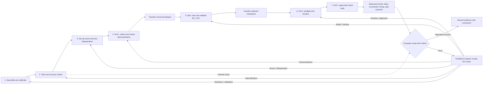
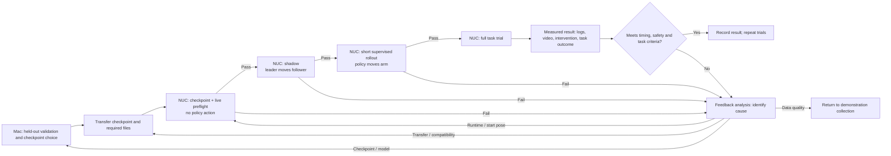

# Mikey17 imitation-learning experiment pipeline

Status: working design. This document describes the workflow; it does not authorize a robot run or imply that every file has already been moved into the proposed layout. See [ROBOT_SETUP.md](ROBOT_SETUP.md) for the hardware and computer setup.

## common used cmd

activate the host on NUC:

```bash
python -m lerobot.robots.lekiwi.lekiwi_host   --robot.id=Mickey17_awesome_kiwi   --robot.port=/dev/ttyACM0   --robot.cameras='{wrist: {type: opencv, index_or_path: "/dev/video0", width: 640, height: 480, fps: 30}}'   --host.connection_time_s=6000
```

rollout:

```bash
cd "/home/team13/Projects/lerobot/atom's/IL"
python deployment/rollout_act_overlap.py \
  --checkpoint checkpoints/act_official_patch4_158_018000 \
  --expected-sha256 c2de68211a91d5fda1dbd47cb57aaef8fa5945df824363ed9f93fb06147a6528 \
  --default-pose default_pose.json \
  --arm-filter-alpha 0.5 \
  --seconds 16 \
  --full-trial \
  --arm
```

## Aim and division of work

Mikey17 is the NUC-connected LeKiwi base and follower arm. The leader arm and wrist camera are used to demonstrate a cube pick-and-place task. The robot hardware stays connected to the NUC; the Mac is the main workspace and runs training. Both computers can be operated from the Mac over SSH, but hardware-facing Python code runs on the NUC.

The current comparison includes three behavior-cloning (BC) policies—direct BC, same-frame residual BC, and three-frame future-residual BC—and an ACT policy. A **policy** maps observations (wrist image and measured joint positions) to arm/gripper commands. ACT predicts a short sequence of commands, called a **chunk**. The robot base is locked for this task, so deployment commands its three velocities to zero.

## Experiment loop



| Stage | Where | Work | Evidence before continuing |
| --- | --- | --- | --- |
| 1. Assemble and calibrate | NUC and robot | Connect robot, leader, and camera; identify ports; calibrate joints and camera focus. | Hardware and calibration checks pass. |
| 2. Define task and criteria | Mac, then physical setup | Specify start pose, cube and target, allowed scene variation, timeout, and what counts as grasp, placement, and success. | A written task definition and observable success criteria. |
| 3. Set up environment and test teleoperation | NUC and robot | Fix the paper mat and camera view; verify leader-to-follower control and record the default pose. | Smooth teleoperation, visible cube/target, and repeatable starting conditions. |
| 4. Collect and review demonstrations | NUC | Record wrist video, measured state, and leader-derived **commanded** actions; inspect episode curves, images, timing, and task outcomes. | A versioned set of usable episodes. Preserve the raw recordings. |
| Transfer dataset | NUC → Mac | Copy a versioned dataset or raw episode set. Check episode count and file integrity. | The Mac copy matches the selected NUC source. |
| 5. Train and validate policies | Mac | Freeze a whole-episode train/validation split; train each BC variant and ACT separately; compare checkpoints on held-out episodes. | Recorded checkpoint, configuration, split, and quantitative/visual review for each candidate. |
| Transfer checkpoint | Mac → NUC | Copy selected model weights and all required configuration/processor files. Record the source and SHA-256 digest. | NUC files match the chosen Mac checkpoint. |
| 6. Pre-deployment checks | NUC | Check checkpoint compatibility, live observations, start-pose alignment, and inference timing; then perform a leader-controlled shadow test. | Checks pass and any prediction/timing concerns are understood. |
| 7. Supervised trials and review | NUC and robot | Begin with a short policy-controlled trial, then a full task trial while a person can stop the robot; review commands, video, timing, and outcome. | Documented success or a specific failure diagnosis. |

Stages 1–3 establish the setup and are repeated when hardware, calibration, task, or scene changes require it. Stages 4–7 form the normal experiment loop. A failed trial returns to the stage responsible for the failure: for example, a camera or timing problem may require stage 3 or 6, while poor demonstrations may require stage 4. A successful single trial is encouraging, but repeated trials are needed to estimate reliability.

## Policy deployment sequence



1. **Mac: offline validation and checkpoint choice.** Evaluate on held-out **episodes** (entire demonstrations excluded from training), including joint-command error, gripper opening/closing timing, and image-based examples. A low offline error does not establish task success.
2. **NUC: checkpoint preflight.** Load the exact transferred checkpoint. Verify model type, wrist image and state shapes, joint order, output units, base-zero mapping, and digest. This step sends no action.
3. **NUC: live observation preflight.** Read one camera frame and measured robot state, check the saved default pose, make a prediction, and measure preprocessing plus inference time. This step sends no policy action. The default-pose tolerance is an alignment check, not a mechanical limit.
4. **NUC: shadow test.** The leader controls the follower while the policy predicts from live observations. Log policy-versus-leader differences and gripper timing. Policy predictions are **never sent** in this mode; the follower can still move under leader control.
5. **NUC: supervised rollout.** After reviewing the shadow log, let policy commands control the arm for a short, bounded trial with the workspace clear and a person ready to stop it. Review the log before increasing trial duration.
6. **NUC: full task trial and review.** Record whether the cube was grasped and placed, as well as video, commands, clipping, overruns, and any intervention. Decide which stage needs improvement.

The same gates apply to BC and ACT; their model loaders and action timing differ. In particular, ACT's measured NUC inference has been around 360 ms, while a 10-action window at 30 Hz lasts about 333 ms. An ACT rollout needs an explicit timing design and a successful timing check; changing the configured chunk length alone does not prove that commands arrive on time.

## Artifact and folder conventions

- **NUC working location (canonical path):** `/home/team13/Projects/lerobot/atom's/IL`. Keep hardware-facing collection, teleoperation, preflight, shadow, trial code, transferred checkpoints, and trial logs here after the planned migration is verified. The existing `IL/default_pose.json` stays the reference pose; existing raw episodes under `atom's/outputs` remain in place.
- **Mac working location:** `lerobot/Atom's/Imitation Learning` within this project. Keep dataset copies, frozen splits, training code, training runs, and offline reviews here.
- Give every dataset and checkpoint a stable version or run ID. Keep an episode-source map and the exact train/validation split. Do not overwrite raw demonstrations or selected checkpoints when a new patch is collected.
- For each trial, record the policy type, checkpoint digest, dataset version, start pose, environment variation, timing, and result. This makes BC-versus-ACT comparisons traceable.

This document defines the experiment sequence. Commands, current paths, and model-specific implementation details belong in the relevant workspace README files and should be checked against the actual files before use.
