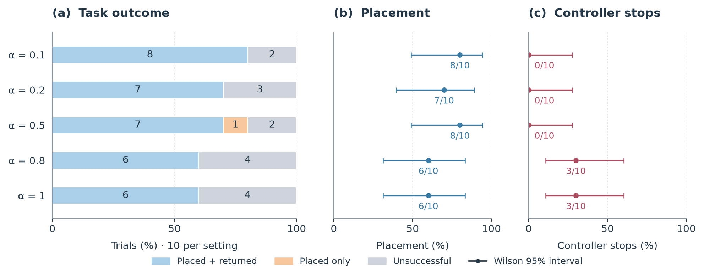
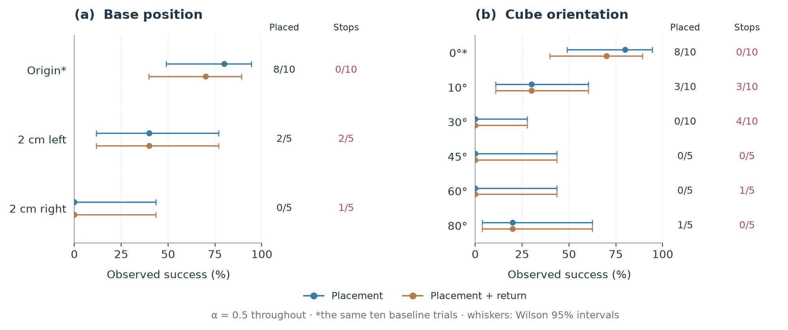
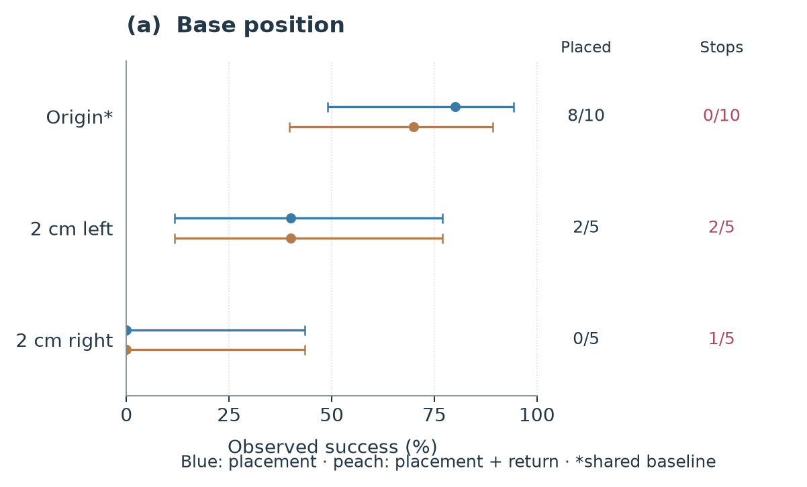
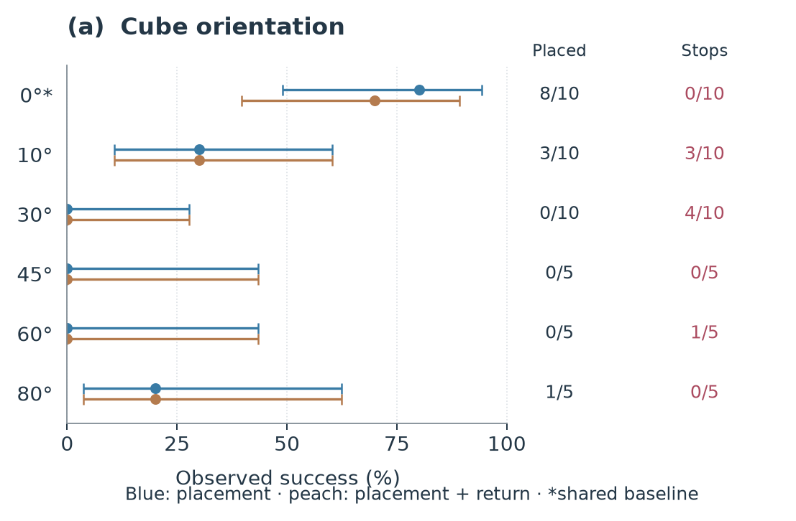
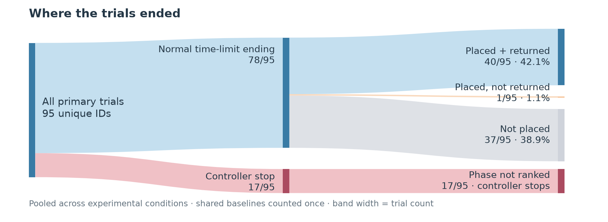
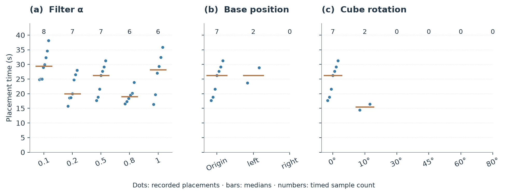
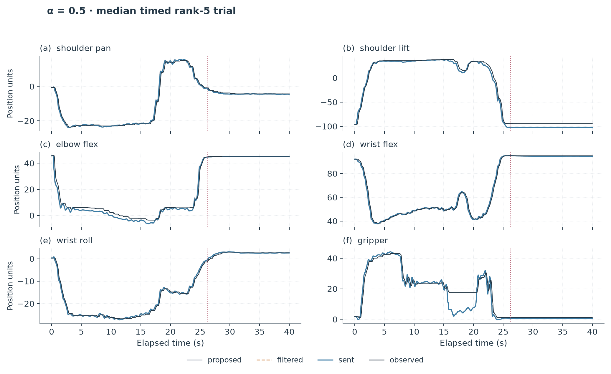
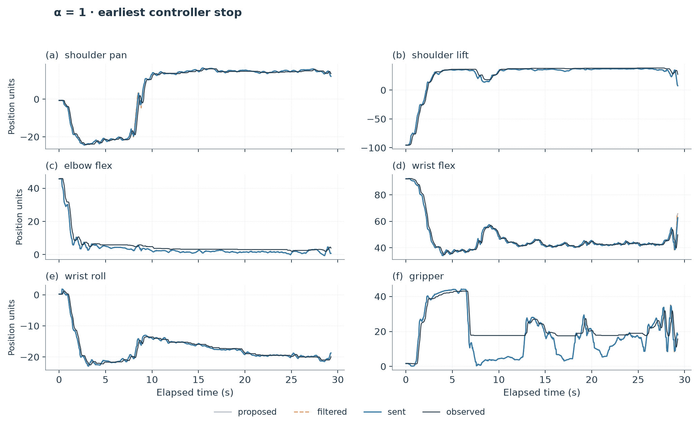
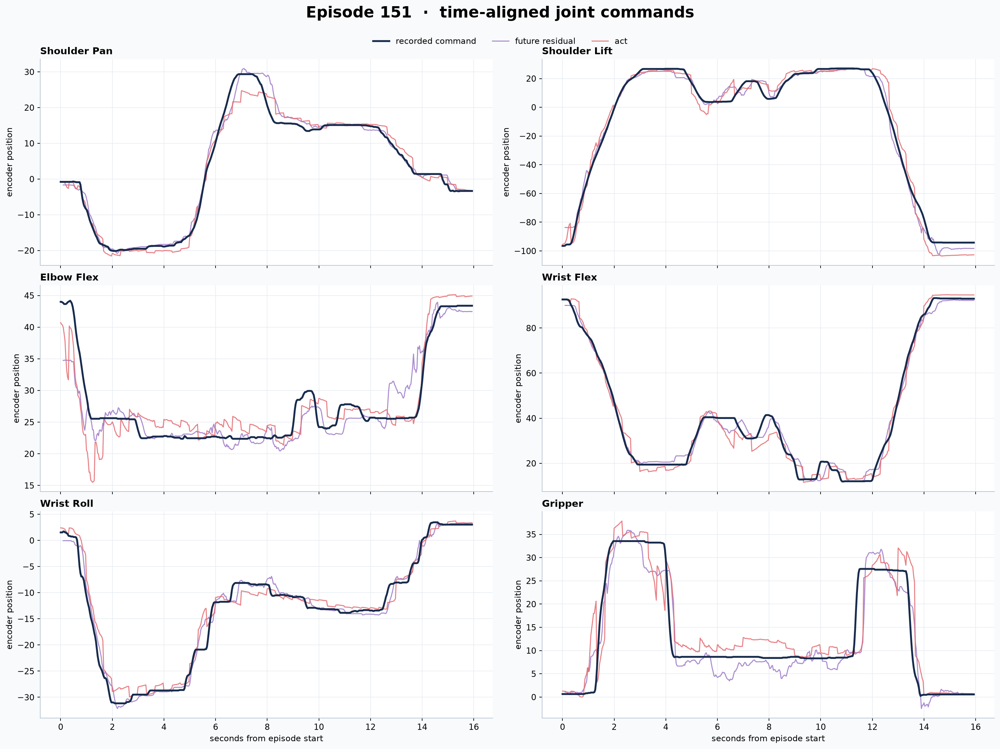

# November 1 outcome study

## Source and accounting

Source archive: `mickey17-outcomes-20261101.tar`, SHA-256
`f9bec52554f3706d93810b7e9e6fade4a4783c83b54151df8f5f4fb58c3ad719`.
It was checksum verified and extracted separately. Original logs, labels,
images and checkpoints were read without modification. The public
[snapshot](../evidence/2026-11-01/outcomes.json) contains per-trial numerical
evidence, source-file hashes, memberships, inference timings and two selected
derived trajectories. Raw camera archives and weights remain local.

There are **107 unique trial IDs in 127 folder memberships**. The ten α = 0.5
trials are byte-identical copies in the base-origin and cube-0° folders. They
support three comparisons but count once toward **95 distinct primary trials**.
The [registry](../analysis/2026-11-01/trial_registry.csv) preserves every ID and
membership. Import checks hash every file in duplicate folders, compare final
manifest/label cycle counts with CSV rows, and compare final statuses.

The nine additional base-right attempts are outside the five-trial α = 0.5
primary group: five at α = 0.2, four at α = 1. They include four Ctrl-C
terminations, four unfinished manifests without labels and one averaged-step
controller stop. Three preliminary α = 0.5 tests include one normal timeout,
one Ctrl-C and one unfinished unlabeled attempt. Two use legacy format-2 labels.
These twelve attempts are supplementary, not silently removed primary failures.
See [audit.json](../analysis/2026-11-01/audit.json).

## Scoring

The [experiment statement](../experiment_statement.md) defines rank 0–5.
**Rank 4 means placed but not yet returned; rank 5 means placed and returned.**
Placement is rank ≥ 4, independent of circle-overlap rating. Controller/runtime
errors and operator interruptions are failures. Missing labels and unfinished
records are unknown. All 95 primary trials have labels; 17 controller errors
with null ranks remain failures in the denominators.

The runtime's historical interactive prompt has a different 1–5 legend. The
study uses the author's explicit clarification and actual 0–5 labels, not that
prompt. The [earlier 70-trial analysis](../analysis/2026-10-25) encoded speed in
`quality_score` and is not pooled with this study.

## Filtering

Panel (a) separates placed-and-returned, placed-only and unsuccessful trials;
numbers inside bands are counts. Panels (b) and (c) show placement and controller
stop proportions, with two-sided Wilson 95% score intervals. Every alpha group
has ten trials. Controller stops remain unsuccessful task outcomes.

α = 0.1 and 0.5 each placed 8/10; α = 0.2 placed 7/10. These three groups had
no controller stops. α = 0.8 and 1 each placed 6/10 and had three stops. At 0.5,
one placement did not return. The [generated table](../analysis/2026-11-01/results_table.md)
contains both success intervals, timed counts and errors for every group.
The intervals overlap widely. These small, sequentially collected groups do
not identify a universally optimal alpha or isolate a causal effect.

## Scene sensitivity

Blue markers show placement and peach markers require return. Whiskers are
Wilson 95% intervals; columns give placed and controller-stop counts with their
actual denominators. Asterisks mark the reused ten-trial baseline.

At α = 0.5, placement fell from 8/10 at origin to 2/5 with the base 2 cm left,
and 0/5 with the base 2 cm right. Controller stops were 0/10, 2/5 and 1/5.

For 0°, 10°, 30°, 45°, 60° and 80°, placements were 8/10, 3/10, 0/10, 0/5,
0/5 and 1/5. The 80° success does not demonstrate monotonic behavior with
rotation. Zero observed success in a small group is not proof of zero
underlying success probability. The shared origin/0° baseline is reused only
as a comparison reference.

## Trial outcome flow

The band widths conserve all 95 distinct primary trials: 78 normal time-limit
endings plus 17 controller stops. Among normally ended runs, 40 were placed
and returned, one was placed without return, and 37 did not place. The 17
controller stops have no phase rank; they remain a separate failed-execution
branch. All terminal percentages use 95 as denominator. This pooled accounting
mixes experimental conditions and is not a baseline success estimate.

## Placement timing

Dots are existing `completion_time_s` measurements, bars are medians and top
numbers are timed sample counts. Only recorded successful placements are
timed. Missing values are omitted and failures are not assigned 40 s.
Alpha medians are 29.44 s (n=8), 19.99 s (n=7), 26.25 s (n=7), 18.97 s (n=6)
and 28.20 s (n=6). These conditional distributions do not establish an overall
speed ranking. The marker includes initial inference hold, operator reaction
time and polling delay; it marks placement, not return.

Three placements lack times: the rank-4 baseline trial ending
`20261030_221242_908468`, rank-5 10° trial `20261031_005408_764159`, and rank-5
80° trial `20261031_015138_801803`. Full IDs are in the audit.

## Six-joint examples

Selection is reproducible: sort normally completed, timed rank-5 α = 0.5 trials
by `(completion_time_s, trial_id)` and select the median; for an even sample
choose the lower middle. For α = 1 select the earliest trial ID with a
controller error. The chosen trials are:

- `act_offset0_overlap_20261030_221026_446645`: rank 5; placement at 26.245 s.
- `act_offset0_overlap_20261030_222520_624170`: averaged-step controller stop.

The plots distinguish queued proposals, filtered proposals, echoed commands
(`sent`) and observed positions. `sent` is a command echoed by the robot
interface, not a motor-position measurement. Units are controller command/
position units, not calibrated physical joint angles. The dotted line marks
operator-reported placement. Error traces end at the last logged cycle; the
proposal that caused the stop can be absent because checks precede logging.
These are selected examples, not population-wide trajectory metrics.

## Controller and inference timing

Primary trials contain eight proposal-envelope/gap stops, four averaged-step
stops and five queue-exhaustion stops. Raw proposal checks precede filtering;
filtering cannot rescue proposals outside those limits. The limits are
empirical demonstration envelopes, not collision detection.

There are **8,300 completed chunk inferences**, counted once by source cycle
within each unique primary trial. Median logged inference time is **321.248 ms**.
Repeated per-step chunk rows and repeated last-inference values in cycle logs
are not independent measurements. This is the logged inference interval, not
end-to-end camera-to-actuator latency or a hard deadline guarantee. Requested
control rate is 30 Hz and replanning every 12 frames targets 400 ms. A 40 s
trial can log fewer than 1,200 control cycles.

## Held-out validation: matching checkpoint verified

The [review metadata](../evidence/2026-11-01/heldout_review.json) selected
`act_zero_offset_official_pipeline/checkpoints/018000/pretrained_model` using
sampled first-action raw MAE. Its local `model.safetensors` SHA-256 is
`c2de68211a91d5fda1dbd47cb57aaef8fa5945df824363ed9f93fb06147a6528`,
matching every outcome manifest. Configuration records zero label offset and
nine state/action channels. The review uses 24 held-out episodes and 16 sampled
observations per episode. Step 018000 has first-action MAE 2.1022 command units
over 384 compared actions. This is neither NUC timing nor closed-loop success.

This preserved figure compares commands on recorded episode 151. Its BC trace
is a historical comparator, not the deployed policy. See [provenance](../evidence/2026-11-01/README.md).
Recorded observations do not test recovery from states reached by the robot.

## Limits

This personal exploratory study uses manual labels, nonrandomized trial order,
imperfect scene resets, small groups and limited variation. Footage includes
a hand steadying the base. Videos have no verified mapping to trial IDs and
illustrate behavior rather than add scored trials. A latency/state-mismatch
mechanism remains a hypothesis; no controlled latency intervention was done.
Weights, demonstrations and the exact installed NUC environment are not
distributed. The current numerical results and figures can be regenerated
from the public snapshot using the [offline guide](REPRODUCE.md).
